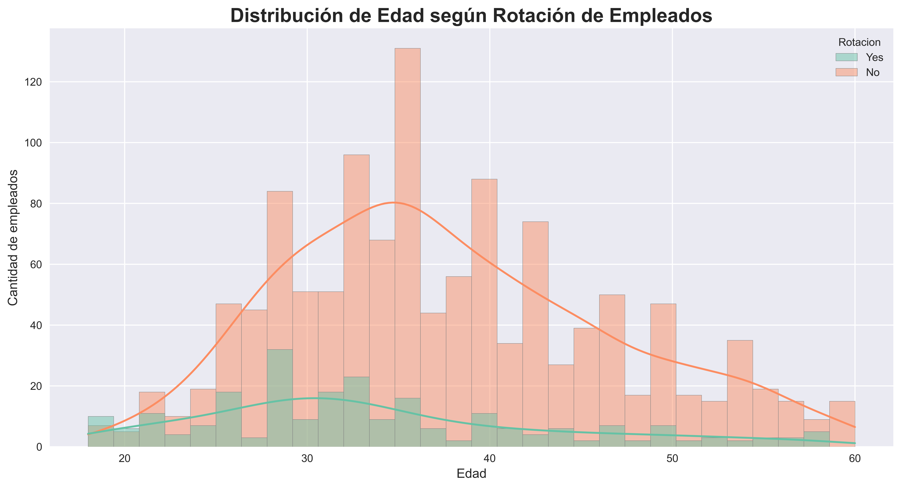
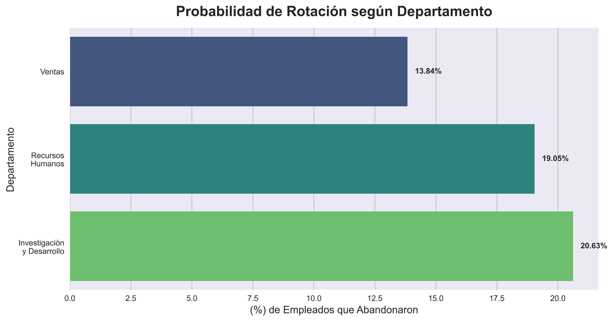
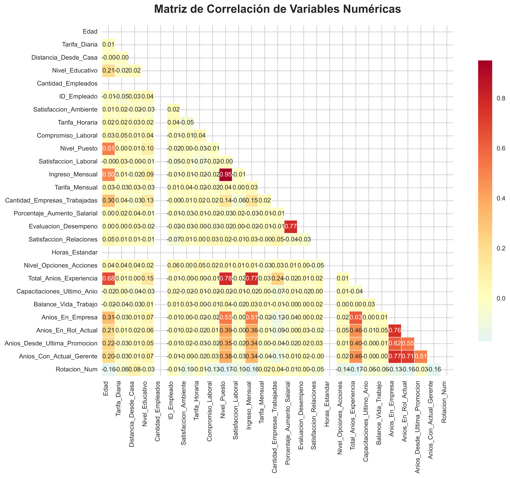
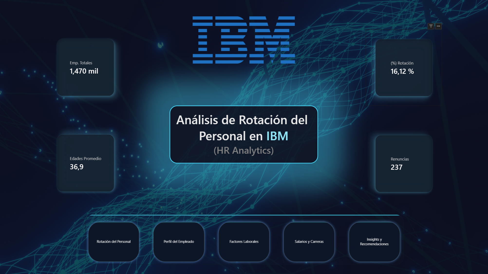

# **📊 IBM HR Analytics: Employee Attrition Analysis**

#### 📌 Descripción del Proyecto

La rotación de empleados representa uno de los mayores desafíos para las organizaciones, ya que impacta directamente en los costes, la productividad y la retención del talento.

En este proyecto se realizó un análisis completo del conjunto de datos "IBM HR Analytics Employee Attrition & Performance", con el objetivo de identificar los factores que influyen en la rotación de empleados y proporcionar información útil para la toma de decisiones en Recursos Humanos.

El análisis fue desarrollado utilizando Python para la limpieza, transformación y exploración de los datos, mientras que Power BI se utilizó para la construcción de un dashboard interactivo orientado al análisis ejecutivo.

---

#### 🎯 Objetivos del Proyecto
- Analizar los factores relacionados con la rotación de empleados.
- Identificar perfiles con mayor riesgo de abandono.
- Detectar patrones asociados a la satisfacción laboral.
- Evaluar el impacto del salario, edad, horas extras y experiencia laboral.
- Construir visualizaciones que faciliten la toma de decisiones basadas en datos.

#### 🛠️ Herramientas Utilizadas
- Lenguajes y Librerías
- Python
- Pandas
- NumPy
- Matplotlib
- Seaborn

#### 🎨 Visualización y BI
- Power BI Desktop
- DAX
- Power Query

#### 🔮 Entorno de Desarrollo
- Jupyter Notebook
- Git
- GitHub

---

#### 📂 Estructura del Proyecto

Proyecto 2 - Analisis de IBM (HR-Attrition)/\
│\
├── data/\
│   ├── Análisis de la rotación de empleados limpio(IBM Attrition Analysis).csv\
│   ├── Pérdida_y_Rendimiento_de_Empleados_en_IBM.csv\
│\
├── notebooks/\
│   ├── Análisis de la rotación de empleados (IBM Attrition Analysis).ipynb\
│\
├── images/\
│   ├── Antiguedad_por_rotacion_empleados.png\
│   ├── distribucion_de_edades_segun_su_rotacion.png\
│   ├── horas_extras_y_rotacion.png\
│   ├── ingresos_mensuales_y_rotacion_empleados.png\
│   ├── matriz_de_correlacion_var_numericas.png\
│   ├── rate_rotacion_por_departamentos.png\
│   ├── rate_rotacion_segun_frecuencia_viajes.png\
│   ├── rotacion_empleados.png\
│   ├── satisfaccion_laboral_y_rotacion_empleados.png\
│\
├── dashboard/\
│   ├── HHRR-ATTRITIO-ANALYSYS/\
│   ├── IBM - Rotacion.pbix\
│\
├── README.md\
└── requirements.txt

---
### 🔍 Metodología del Proyecto

#### 1️⃣ Comprensión del Dataset

Se realizó una exploración inicial para comprender:

- Número de empleados.
- Variables disponibles.
- Distribución de categorías.
- Calidad de los datos.
- Valores faltantes y duplicados.

#### 2️⃣ Limpieza y Preparación

Durante esta etapa se:

- Verificaron tipos de datos.
- Analizaron valores nulos.
- Revisaron inconsistencias.
- Prepararon los datos para el análisis exploratorio.

#### 3️⃣ Análisis Exploratorio de Datos (EDA)

Se estudiaron variables relevantes como:

- Edad
- Género
- Estado civil
- Ingresos mensuales
- Horas extras
- Satisfacción laboral
- Años en la empresa
- Nivel de puesto
- Distancia al trabajo

y su relación con la variable objetivo:

Attrition (Rotación de Personal) IBM

#### 4️⃣ Visualización de Datos

Se desarrollaron gráficos para detectar patrones y tendencias relacionadas con la permanencia o abandono de empleados.

#### 5️⃣ Dashboard Interactivo en Power BI

Se creó un dashboard con filtros dinámicos que permite:

- Analizar rotación por departamento.
- Evaluar perfiles de riesgo.
- Comparar variables demográficas.
- Explorar indicadores de desempeño y permanencia.

### 📈 Principales Hallazgos

Entre los hallazgos más relevantes del análisis se identificó que:

✅ Los empleados que realizan horas extras presentan mayores tasas de rotación.

✅ Los trabajadores con menor antigüedad tienden a abandonar la empresa con más frecuencia.

✅ Determinados grupos de edad muestran una mayor propensión a la rotación.

✅ La satisfacción laboral y el equilibrio entre vida laboral y personal están relacionados con la permanencia del empleado.

✅ El nivel salarial puede influir en las decisiones de permanencia dentro de la organización.

---

## 📊 Dashboard en Power BI

**Indicadores Principales**
- Total de Empleados
- Total de Bajas
- Tasa de Rotación
- Edad Promedio
- Ingreso Promedio
- Distribución por Departamento

**Análisis Disponibles**
- Rotación por Edad
- Rotación por Género
- Rotación por Cargo
- Rotación por Horas Extras
- Rotación por Estado Civil
- Rotación por Nivel Salarial

### 💼 Competencias Demostradas
- Data Cleaning
- Data Wrangling
- Exploratory Data Analysis (EDA)
- Data Visualization
- Business Intelligence
- HR Analytics
- Storytelling con Datos
- Power BI
- DAX
- Git & GitHub

---

## 👨‍💻 Autor:
**Alejandro G. Araujo L.**

📍 Data Analytics Portfolio Project

**GitHub:** https://github.com/AlessoLeon/ \
**LinkedIn:** https://www.linkedin.com/in/araujo-alejandro/
